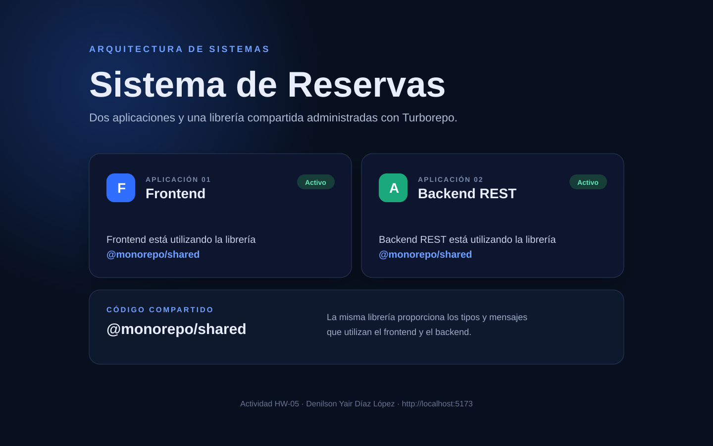
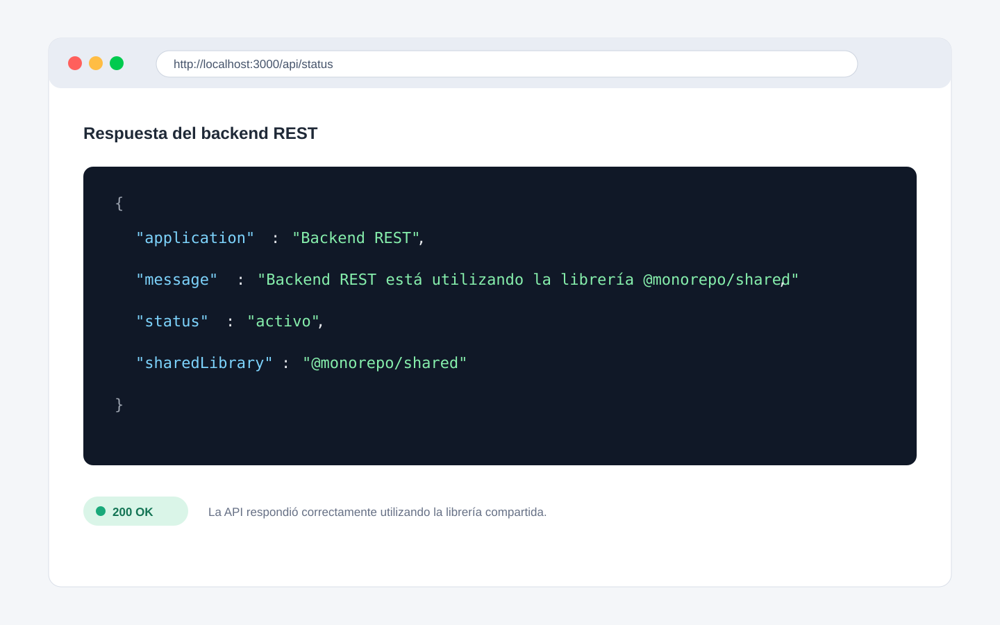

# Monorepo con Turborepo

Proyecto realizado para el curso **Arquitectura de Sistemas**. Contiene dos aplicaciones y una librería compartida, administradas desde una sola raíz mediante npm Workspaces y Turborepo.

## Información del estudiante

- **Nombre:** Denilson Yair Díaz López
- **Actividad:** HW-05
- **Rama:** `hw-05`

## Estructura del monorepo

```text
API_Cuatro_Metodos/
├── apps/
│   ├── frontend/          Aplicación web creada con Vite y TypeScript
│   └── backend/           API REST creada con Express y TypeScript
├── packages/
│   └── shared/            Tipos y funciones utilizados por ambas aplicaciones
├── package.json           Workspaces y comandos generales
├── tsconfig.base.json     Configuración común de TypeScript
└── turbo.json             Tareas administradas por Turborepo
```

## Herramienta utilizada

Se eligió **Turborepo** porque permite administrar varias aplicaciones y librerías desde un mismo repositorio. Organiza el orden de las tareas, reutiliza resultados mediante caché y permite ejecutar todos los proyectos juntos o cada aplicación de manera independiente.

npm Workspaces conecta los paquetes internos. Por esa razón, el frontend y el backend pueden importar la librería `@monorepo/shared` sin publicarla en un registro externo.

## Aplicaciones y librería compartida

### Frontend

Presenta una interfaz que muestra el estado del frontend y consulta el estado del backend. Utiliza una función de `@monorepo/shared` para crear su mensaje.

- Dirección: `http://localhost:5173`

### Backend

Expone una API REST con una ruta que devuelve el estado del servicio en formato JSON. La respuesta se construye con una función y un tipo definidos en `@monorepo/shared`.

- Dirección principal: `http://localhost:3000`
- Endpoint: `GET http://localhost:3000/api/status`

### Librería compartida

El paquete `packages/shared` contiene el tipo `SystemStatus` y las funciones `createSystemMessage()` y `createSystemStatus()`. Las dos aplicaciones importan estas funciones, lo que evita repetir código.

## Requisitos

- Node.js 20 o superior.
- npm 10 o superior.
- Git.

## Ejecución desde cero

1. Clonar el repositorio:

```bash
git clone https://github.com/DenilsonDiaz/API_Cuatro_Metodos.git
```

2. Entrar al proyecto y cambiar a la rama de la actividad:

```bash
cd API_Cuatro_Metodos
git switch hw-05
```

3. Instalar todas las dependencias desde la raíz:

```bash
npm install
```

4. Ejecutar el frontend y el backend al mismo tiempo:

```bash
npm run dev
```

5. Abrir `http://localhost:5173` para observar el frontend. La API estará disponible en `http://localhost:3000/api/status`.

## Comandos disponibles desde la raíz

| Comando | Función |
|---|---|
| `npm install` | Instala las dependencias de todos los workspaces. |
| `npm run dev` | Ejecuta ambas aplicaciones en modo de desarrollo. |
| `npm run dev:frontend` | Ejecuta solamente el frontend. |
| `npm run dev:backend` | Ejecuta solamente el backend. |
| `npm run build` | Compila todas las aplicaciones y librerías. |
| `npm test` | Ejecuta todas las pruebas. |
| `npm run check` | Comprueba los tipos de TypeScript en todo el monorepo. |

## Conventional Commits

Los commits de la actividad siguen la especificación Conventional Commits. Se utilizan prefijos como `feat:` para funcionalidades, `test:` para pruebas y `docs:` para documentación.

## Evidencias

Las aplicaciones muestran de forma visible el nombre `@monorepo/shared`. Esto confirma que ambas utilizan la misma librería compartida.

### Frontend funcionando



### Backend funcionando


