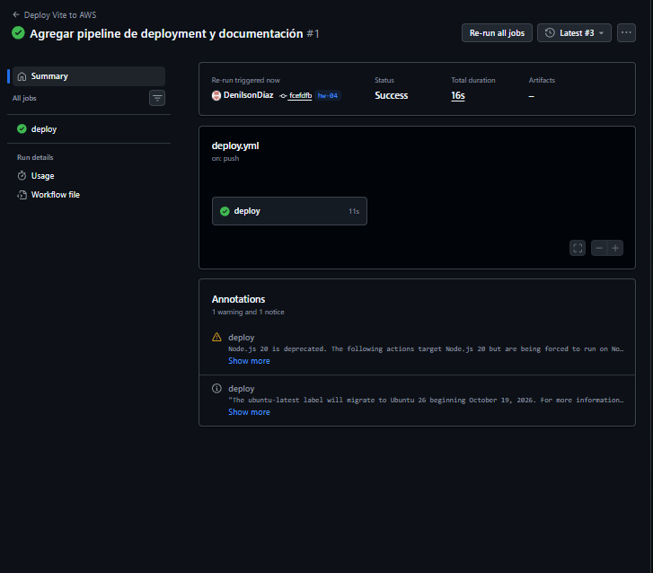
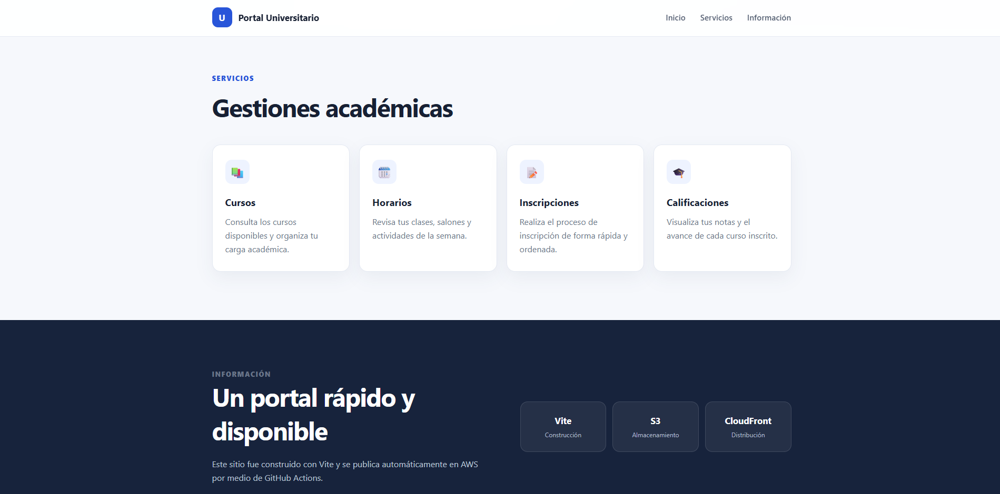

# HW-04 - Deployment de Vite en AWS

Página web creada con Vite y preparada para publicarse automáticamente en Amazon S3 y CloudFront mediante GitHub Actions.

## Tecnologías

- Vite
- HTML, CSS y JavaScript
- GitHub Actions
- Amazon S3
- Amazon CloudFront

## Ejecutar el proyecto

Se necesita tener instalado Node.js 22 o una versión compatible.

```bash
git clone -b hw-04 https://github.com/DenilsonDiaz/API_Cuatro_Metodos.git
cd API_Cuatro_Metodos
npm install
npm run dev
```

Vite mostrará la dirección local del proyecto en la terminal.

## Generar la versión de producción

```bash
npm run build
npm run preview
```

El comando `npm run build` crea la carpeta `dist/` con los archivos optimizados.

## Pipeline de deployment

El workflow `.github/workflows/deploy.yml` se ejecuta al subir cambios a la rama `hw-04` o de forma manual desde GitHub Actions. El proceso realiza lo siguiente:

1. Instala las dependencias con `npm ci`.
2. Genera el build con `npm run build`.
3. Copia el contenido de `dist/` al bucket de S3.
4. Invalida la caché de CloudFront.

El repositorio utiliza estos secretos de GitHub Actions:

- `AWS_ACCESS_KEY_ID`
- `AWS_SECRET_ACCESS_KEY`
- `AWS_REGION`
- `S3_BUCKET_NAME`
- `CLOUDFRONT_DISTRIBUTION_ID`

## Sitio publicado

El sitio se encuentra disponible mediante CloudFront:

**URL:** [https://d3mdipds4au9nj.cloudfront.net](https://d3mdipds4au9nj.cloudfront.net)

## Evidencias

### Ejecución correcta del pipeline



### Sitio publicado en CloudFront



